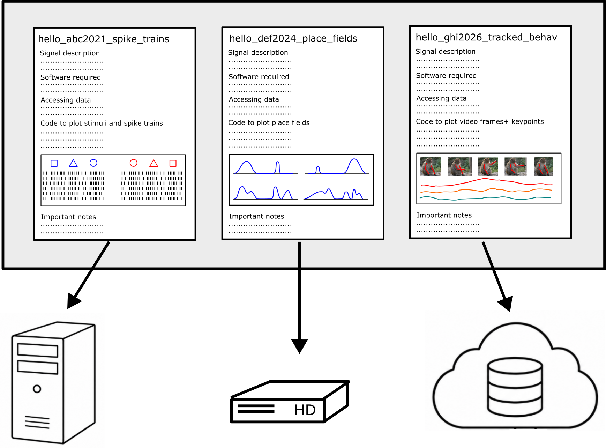

# How to index a lot of heterogeneous neuroscience data
**Rich Pang**

2026-10-15

While such a task may seem daunting, involving extensive and expensive infrastructure and pipeline engineering, it could also be much simpler and cheaper than it sounds.
A collection of [`hello_signal`](https://neurotaxis.org/blog/2026/hello_signal.html) files provides a simple, practical, flexible and low-cost gateway to an arbitrarily large set of complex, heterogeneous datasets that makes initial assessment of their accessibility and relevance to specific research questions fast and easy.

## An index for diverse signals

A good index doesn't take up much space yet makes it easy to search for what you're looking for.
Usually what we're looking for in neuroscience is not simply data with a specific shape or size, but clear, specific signals relevant to our scientific interests.
Thus, while standardizing data file formats, e.g. via the [NWB format](https://nwb.org), can be helpful for simplifying software and processing pipelines, it is also extremely useful to be able to quickly glance at what the main signals in a dataset look like before even touching the data files themselves. 
The latter is particularly useful if one wants to scan through a number of candidate datasets without having to download, open and inspect each one individually.
A `hello_signal` file attempts to achieve exactly the latter while also providing clear, minimal instructions for accessing and working with the data should you subsequently choose to do so.

## What is a `hello_signal` file?

As described in a previous [post](https://neurotaxis.org/blog/2026/hello_signal.html), a `hello_signal` file is a one-size-fits-all PDF that provides (1) unambiguous instructions for accessing and plotting an important signal in a dataset; (2) clean, representative examples of what the signals in the data actually look like, ideally giving a sense of the SNR as well; (3) all the basic numbers about number of animals, trials, stimuli, etc, and the file types and sizes that comprise the dataset; and (4) essential notes on experimental context to ensure that the signals, as well as any artifacts, do not get misinterpreted.
`hello_signal` files require no specific software (whatever language and code were used to plot the data is fine), no reformatting or refactoring, no moving data to any specific storage systems, no AI, and in general no additional technology at all, which makes them extremely flexible, robust, and easy to make.
Ideally, a stack of `hello_signals` can be printed out and left by a department coffee machine for curious investigators to browse at their leisure to see which signals might be relevant to their research interests.

In my personal experience, creating a `hello_signal` file for a dataset before beginning any analyses whatsoever is extremely useful for every subsequent scientific inquiry and saves a ton of time down the line by making it quick and easy to come back to it or onboard a collaborator.
You can find some examples of `hello_signal` files in my previous [post](https://neurotaxis.org/blog/2026/hello_signal.html).

## Advantages of `hello_signal` files

Neuroscience data grows more complex and heterogeneous by the day.
`hello_signal` files work in harmony with this observation rather than attempting to standardize things, since each `hello_signal` file is simply a PDF.
That said, they naturally complement efforts to standardize certain data formats, e.g. in the [NWB](https://nwb.org) project. 
A main goal of a `hello_signal` file is to give the reader a sense not only of what the signal looks like, but how easy it will be to access and work with it—hence, if a `hello_signal` file indicates that a common file format is used, this may indicate greater accessibility than a custom file type created by a specific lab.
Moreover, since the data-access portion of a `hello_signal` file is essentially a pointer to where the data live and how to access them, `hello_signal` files do not require any reorganization of data storage.
They are equally compatible with datasets stored in the cloud or on a hard drive tucked away in a file cabinet—what they provide is a sense of how complicated the data will be to access and work with and, critically, what the signal in the data looks like.

A further advantage of `hello_signal` files is that by design they prioritize signal over data.
While modern science celebrates big data, really big signal is what we're after.
One of the main purposes of a `hello_signal` file is to display several representative examples of exactly what you expect to see when you do load the data.
Notably, this can be quite different from the plots reported in a paper, which for conciseness usually provide few, if any, examples of the raw signals someone would observe if they loaded the data on their own computer.
Being able to quickly scan through several printed examples of what the real signal in a dataset looks like, on the other hand, can be extremely helpful for assessing whether a dataset will likely be useful to dig into more deeply for a novel project.

## How to make a `hello_signal` file

AI might be helpful here, but it really isn't critical.
While in principle AI makes it much easier to automate the data "munging" process (loading data, reshaping matrices, etc.), e.g. for translating docs into code, two problems can nonetheless emerge when munging someone else's data.
First, even given extensive documentation, it is easy to make small mistakes when loading the data that don't throw any errors but can critically affect one's scientific findings.
Second, in the life sciences experimental context is of utmost importance, and even good analyses applied to good datasets without proper contextual knowledge can lead to unsound results.
For instance, there is substantial variety in animal handling and rearing across experimental lab, as well as individual variability across animals, and there is often extensive in-house, unpublished knowledge of which animals in an experiment likely produced higher quality data.

Thus, the best person to make a `hello_signal` file is someone very close to the data, who knows what the real signal looks like and is intimately familiar with the experimental context.
Luckily, if they have been working with and plotting the data already, making a `hello_signal` file is extremely easy, and essentially involves no more than copy-pasting the existing plotting code and adding a few more notes about repeats, file sizes, and experimental context.

## How to collect a bunch of `hello_signal` files

Since the most qualified people to write `hello_signal` files for a dataset are those closest to the data, should an organization be interested in aggregating a large number of such files I think the best approach may simply be to kindly ask them.
There are some important points to consider, however.
First, although more accessible data generally advantages reproducibility, there are many reasons a scientist might not want to immediately share their data, in particular if their corresponding paper(s) are not published yet, but also if certain aspects of the data are likely to be misinterpreted, if the data contains sensitive information, and so forth.
Second, collecting good data can be extremely difficult and often takes years of labor. Although scientific reproducibility is important, it is also useful to remember how much time and effort goes into experimentation and that an experimentalist might very reasonably not want to give immediate access to anyone who requests it.
Third, even though in principle it is quite simple to create a `hello_signal` file if one is already working with the signals, it can be highly valuable in increasing the impact of these signals in advancing scientific knowledge.
Hence, especially if an organization is creating an index of `hello_signal` files for either internal or external use, I think it may be quite reasonable to offer compensation to those who produce them, as an acknowledgment of the immense value of having the signals in question vetted by someone intimately familiar with them.

## An implicit design principle of `hello_signal` files

Something perhaps worth noting is that the essential object underlying a `hello_signal` file is a self-contained dataset.
This stands in contrast to data that are continually growing and changing, without clear boundaries for when a set of experiments started and ended (a natural and expected phenomenon in the highly iterative nature of science).
Keeping the format of a `hello_signal` in mind, however, encourages one to group data into bounded, self-contained datasets.
This level of clustering also makes archiving data for later re-use much easier.

## Automating signal mining

`hello_signal` files represent a level abstraction that could drastically simplify something like an automated "semantic search" for specific or interesting types of signals in neuroscience data.
Their advantage over standard documentation is that they already contain example plots of what the signals look like, along with a concise presentation of how easy or complicated it will be to access and work with the data.
Their advantage over published papers is that they contain many representative examples of the signals in question, giving a much stronger sense of what it will be like to work with a specific signal in a specific dataset.
These observations are particularly relevant in modern times in which AI systems have become increasingly good at parsing text and images, and which in combination with an index of `hello_signal` files could greatly accelerate our ability to truly make the most out of existing neuroscience data by helping produce an accessible mapping between scientific questions and the datasets most relevant to answering them.